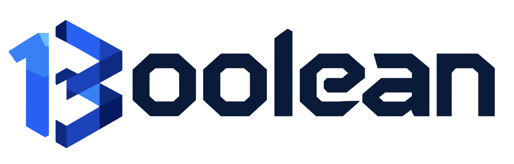

<div align="center">

<!-- Logo del gruppo: metti l'immagine in una cartella del repo (es. /assets/logo.png)
     oppure usa un URL assoluto. Regola width a piacere. -->


**Gruppo 13 – Corso di Ingegneria del Software**
Università degli studi di Padova · A.A. 2026/2027


</div>

---

## Il gruppo

**13oolean** è il gruppo 13 del corso di **Ingegneria del Software** del I Lotto per l'Anno Accademico 2026/2027.

L'organizzazione/repository GitHub è utilizzata per la gestione e lo sviluppo del progetto, realizzato nell'ambito del corso.

---
<!--
## Progetto

### [Nome Progetto]

[Descrizione sintetica del progetto in 3-5 righe: cos'è, a chi si rivolge, quale problema risolve e con quali tecnologie.]

**Funzionalità principali:**

* [Funzionalità 1]
* [Funzionalità 2]
* [Funzionalità 3]

**Tecnologie utilizzate:**

* [Linguaggio / Framework]
* [Database]
* [Altri strumenti]

---
-->
## Componenti del gruppo

| Nome e Cognome   | Matricola |
| ---------------- | --------- | 
| Francesco Cirigliano   | 1163662 |
| Gabriele	Maria D'Amico  | 2111023  | 
|Andrea	Guerra| 2137978  | 
| Giacomo	Lazzarotto   | 2147992 | 
| Davide	Menegaldo   | 2147950  | 
| Michele	Tosato   | 2137989  | 

---

## Risorse

* **Repository principale:** https://github.com/gruppo13oolean-dev/Documentazione
* **Documentazione di progetto:** https://github.com/gruppo13oolean-dev/Documentazione/tree/main/output
* **Sito web del gruppo:** https://13oolean-documentazione.vercel.app/

---

## Struttura del repository

```text
.
├── output/          # Documentazione PDF
├── src/            # Risorse e file .tex
├── website/             # Codice sorgente
└── README.md
```

## Contatti

Email ufficiale del gruppo: 

**gruppo13oolean@gmail.com**

---

## Nota

La presente organizzazione è utilizzata esclusivamente per finalità didattiche nell'ambito del corso di Ingegneria del Software dell‘Università di Padova.
